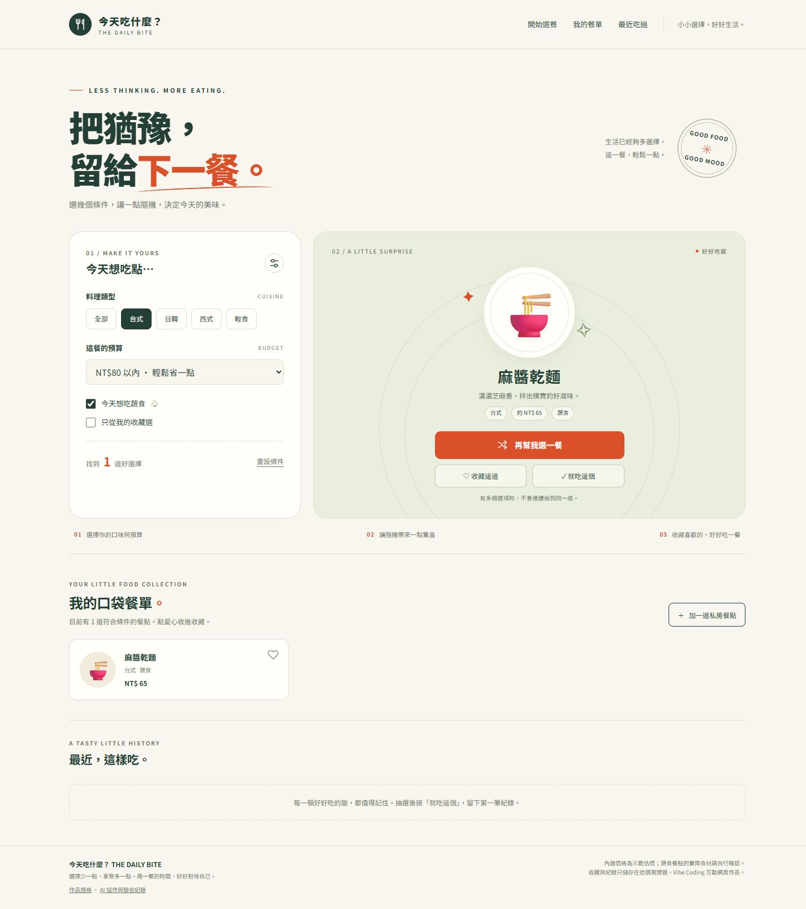

# 「今天吃什麼？」AI 協作與驗收紀錄

日期：2026-10-16

此紀錄整理本次實際發生的需求確認、製作、檢查與修正。不是虛構的訪談或提示詞對話；「測試通過」與「待驗證」分開記錄。

## 一、需求如何形成

1. 使用者提供作業要求：和 AI 討論構想、整理規格書、完成單一 `index.html`，並透過 GitHub Pages 公開。
2. AI 提議「今天吃什麼？」餐點抽選器；使用者選擇此主題。
3. AI 先建立規格書，明確定義料理、預算、蔬食、收藏、自訂餐點、選餐紀錄與資料保存規則，再完成程式。
4. 使用者確認已有 GitHub 帳號，授權建立新的公開作業儲存庫。作品發布於 `Wongbenben/what-to-eat`，沒有覆寫原先的私人專案。
5. 使用者補充 9～10 分評分標準並要求符合滿分要求，因此進行第二輪實際網站驗收與文件補強。

## 二、實際迭代過程

### 第一輪：從構想到可執行作品

- 問題：用餐時難以決定要吃什麼。
- 規格：先篩選，再抽選；沒有符合項目時要提供明確提示。
- 實作：24 道餐點、交叉篩選、隨機抽選、收藏、自訂餐點、最近 8 筆紀錄與瀏覽器保存。
- 驗證：JavaScript 語法及模擬 DOM 邏輯測試通過，GitHub Pages 公開網址回傳 HTTP 200，發布內容與交付檔案一致。
- 限制：初輪本機瀏覽器預覽受到環境及安全政策限制，沒有把未完成的畫面驗收宣稱為通過。

### 第二輪：依評分標準操作公開網站，找到真正的錯誤

- 驗收方式：直接操作已發布的 HTTPS 網站，查看實際 DOM 與畫面。
- 發現：預算選單中的「NT$80 以內」顯示成普通文字，不能當作選項選取。
- 原因：第一個預算選項的結尾誤寫成 `</option value="80">`，遺漏下一個選項的開始標籤。
- 修正：改成獨立的 `</option>` 與 `<option value="80">`，並把四個選項拆行，提升可讀性。
- 防止重犯：增加 HTML 結構檢查，確認結束標籤不含屬性，以及四個預算選項 `9999 / 80 / 150 / 250` 都實際存在。
- 測試反思：先前模擬 DOM 測試直接設定數值，能驗證篩選邏輯，但無法發現原始 HTML 的選項缺漏；因此補上結構檢查與真實瀏覽器操作，兩種測試各自補足另一種的盲點。

### 第三輪：改善新增與確認操作

| 實際發現／檢查重點 | 修改前 | 修改後 | 再驗收 |
| --- | --- | --- | --- |
| 加入成功卻不易找到餐點 | 自訂餐點排在 24 道內建餐點後，預設前 6 張卡片看不到它 | 最新自訂餐點排在前面，符合條件時立即可見 | 新增測試餐點後，第一張卡片就是該餐點，24→25 道 |
| 刪除與清除的確認操作 | 使用同步的原生 confirm；測試期間曾中斷瀏覽器工具操作 | 改為頁內 dialog，標明影響範圍，預設焦點放在「先不要」，可按 Esc | 取消與 Esc 都不改資料，確認後才移除；刪除後焦點回到新增按鈕 |

這次調整保留原本規格的確認機制，改善操作方式；沒有把工具逾時直接當作「所有瀏覽器都壞掉」的證據。

### 第四輪：補齊驗收與繳交證據

- 在網站頁尾加入「作品規格」及「AI 協作與驗收紀錄」連結。
- 規格書增加 F01～F16 對照表，連結功能、畫面、預期結果與測試方式。
- 對修正版做實際瀏覽器操作、重新整理保存、鍵盤及 320／390／1440 px 畫面驗收。
- 保存真實桌機與手機截圖、原始驗收結果，以及可重跑的 HTML／邏輯檢查腳本。
- 更新公開儲存庫與完整作業包。測試用的餐點、收藏及紀錄已清理，沒有留在作品初始資料裡。

### 可追溯的程式修改

| 修改 | Git 提交證據 |
| --- | --- |
| 初版單檔網頁 | [b59ed62](https://github.com/Wongbenben/what-to-eat/commit/b59ed628d1e936834c0c3ae2d6b9d5f4a827c570) |
| 修正 80 元預算選項 | [003394c](https://github.com/Wongbenben/what-to-eat/commit/003394c25c76f644b42764f1352f78dec5409a87) |
| 私房餐點優先顯示 | [729e555](https://github.com/Wongbenben/what-to-eat/commit/729e55506c08bdef3600a7f0d3081a231f0d9e08) |
| 可取消的頁內確認視窗 | [243489c](https://github.com/Wongbenben/what-to-eat/commit/243489ce9d5079c703a5f77b9a44365f055fa7ba) |

## 三、修正版的真實瀏覽器驗收結果

驗收網址：https://wongbenben.github.io/what-to-eat/

驗收環境：內建 Chromium 瀏覽器；下列項目實際透過控制項操作，不是只看程式碼推定結果。

| 編號 | 操作 | 實際觀察 | 結果 |
| --- | --- | --- | --- |
| T01 | 切換四種預算 | 無自訂餐點時，80／150／250／不限分別為 7／14／24／24 道 | 通過 |
| T02 | 台式＋80 元內＋蔬食 | 只剩麻醬乾麵，NT$65；抽選結果相符 | 通過 |
| T03 | 收藏一個自訂餐點並只從收藏選 | 只有 1 道候選，抽選只能得到它 | 通過 |
| T04 | 沒有收藏時勾選只從收藏選 | 候選為 0，顯示空狀態並停用抽選；重設後可使用 | 通過 |
| T05 | 僅收藏滷肉飯、日式咖哩飯，連抽 10 次 | 日式咖哩飯 → 滷肉飯 → 日式咖哩飯 → 滷肉飯，持續交替共 10 次，沒有立即重複 | 通過 |
| T06 | 抽選動畫期間嘗試更改預算 | 預算選單停用，完成後恢復，避免結果與條件不一致 | 通過 |
| T07 | 按就吃這個 | 新增 1 筆紀錄，該次接受按鈕停用；多次選餐後上限為 8 筆 | 通過 |
| T08 | 新增、收藏、記錄後重新整理 | 自訂餐點、收藏狀態及紀錄仍存在 | 通過 |
| T09 | 輸入已有餐點名稱／空白名稱 | 顯示錯誤，不增加餐點 | 通過 |
| T10 | 價格填 -1 後送出 | HTML 數值驗證阻擋，表單保持開啟，餐點仍為 24 道 | 通過 |
| T11 | 新增 NT$72 的測試餐點 | 餐點 24→25，新增項目在第一張卡片 | 通過 |
| T12 | 移除測試餐點，先取消再確認 | 取消後 25 道，確認後 24 道，焦點回到新增按鈕 | 通過 |
| T13 | 清除 8 筆紀錄，測試 Esc／取消／確認 | Esc 與取消都保留 8 筆，確認後為 0 筆 | 通過 |
| T14 | 用 Enter 啟動抽選，Esc 關閉表單 | 可操作；aria-live 狀態區顯示「抽到了麻醬乾麵，台式，約新臺幣65元。」 | 通過 |
| T15 | 320／390／1440 px 視窗 | 文件寬度與捲動寬度分別為 305／305、375／375、1425／1425，皆無橫向溢位；手機新增表單可用 | 通過 |
| T16 | 檢查瀏覽器錯誤日誌、清理測試資料 | 測試頁錯誤日誌為空；餐點回到 24 道、紀錄 0 筆，測試收藏移除 | 通過 |

瀏覽器視窗保留捲軸，所以文件可用寬度比設定視窗寬度少 15 px。這是尺寸測試，並非實體手機測試。

原始結果：[browser-results.json](./evidence/browser-results.json)。

## 四、其他檢查與驗證範圍

- HTML 結構檢查：結束標籤不得包含屬性；四個預算選項與表單選項必須存在。用於防止這次缺漏再次發生。
- JavaScript／模擬 DOM 檢查：語法、ID 對應、數值邊界、篩選組合、抽選、收藏、自訂新增／刪除、確認前不改資料、紀錄上限、使用者文字跳脫、儲存資料損壞與禁止寫入等。
- 公開發布：GitHub Pages 已啟用，公開 HTTPS 頁面可讀取，內容與交付的 index.html 核對一致。
- 上述本機檢查沒有模擬真實瀏覽器渲染，因此另以第三節的真實操作與截圖補足；沒有將模擬測試冒稱為實機測試。
- 尚未測試所有瀏覽器品牌、實體手機或真人螢幕閱讀器；不影響本次已列出的實測結果，也不把未知範圍標記為通過。

可重跑的腳本位於 [verification](./verification/)，執行方式見 [README](./README.md)。

## 五、畫面證據

桌機截圖展示「台式＋80 元內＋蔬食」的實際抽選結果，而非設計稿。

[查看完整手機版截圖](./evidence/mobile.png)

## 六、作品連結

- [公開網站](https://wongbenben.github.io/what-to-eat/)
- [程式與文件](https://github.com/Wongbenben/what-to-eat)
- [規格書](./規格書.md)
- [實際 Git 提交紀錄](https://github.com/Wongbenben/what-to-eat/commits/main/)

實際成績由教師依課程標準評定；本紀錄提供可檢查的證據，不以「保證滿分」取代實際驗收。
